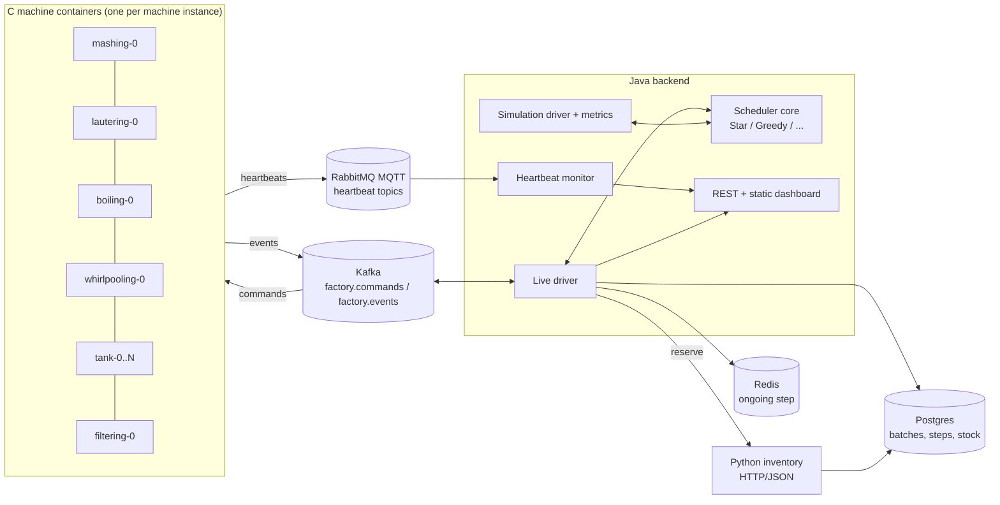

# Beer Factory implementation plan (v2)

Written 19 November 2026 against commit `5778335` and the UPPAAL model
`src/docs/Beer_Factory.xml`. Supersedes the plan of 27 October (Java/Go/Postgres
stack); what the group actually built since then is C machines, a C scheduler
sketch, MQTT heartbeats and Kubernetes manifests, so the plan starts from that.

Goal: a running prototype of the production line **and** an experiment that
compares several scheduler versions on factory efficiency. Report deadline:
18 December. Everything here must be explainable at the exam, so the plan has
three rules and no speculative features.

## 1 Rules

1. **Code mirrors the model.** Each machine program is the UPPAAL template of
   the same name: same locations, guards, updates and durations (hours in the
   model, seconds in C, scaled in the demo). Each scheduler version is a
   variant of the `Scheduler` template. When code and model disagree, one of
   them is fixed the same week; the traceability table in section 8 is the
   checklist.
2. **One scheduler core, two drivers.** Scheduler logic is written once and
   knows nothing about Kafka, MQTT or wall clocks. The *simulation driver*
   runs it against in-memory machines with a virtual clock (the experiment:
   hundreds of runs in seconds, deterministic). The *live driver* runs the same
   core against the C machine containers over Kafka (the prototype). Same
   events, same commands, same metrics code.
3. **A new scheduler version is one class and one registry line.** No other
   file changes. The experiment runner picks versions by name.

## 2 What exists and what happens to it

| Path | Author | State today | Plan |
| --- | --- | --- | --- |
| `src/docs/Beer_Factory.xml` | all | compiles; Scheduler hub has a known deadlock (mash #2 and lauter #1 finish in the same hour, committed `Lauter` location blocks) | fix with a busy flag per stage (`is_lautering` like `is_mashing`); this is the reference for `StarScheduler` |
| `beer_factory/boiling`, `whirlpooling`, `lautering` (PR #14), `fermentation_maturation` | Nicola, Márton, Jędrzej, Nicola | state machines in seconds, result codes, tests; `main.c` runs one hard-coded batch and sends heartbeats | keep the state machines unchanged; replace `main.c` loop by the common machine loop of section 6.2 |
| `beer_factory/mashing`, `filtering` | Katrín, Vera | `mashing` is a heartbeat stub; `filtering.c` implements Vera's C `MachineType` interface | write `mashing.c/.h` boiling-style; rewrite `filtering.c` boiling-style (4 h, one output counter); same common loop |
| `beer_factory/machine_commons/machine_mqtt` | Nicola | MQTT-C heartbeat library, 5 s interval, payload = two `int`s (timestamp, machine index), broker hard-coded `localhost:1883` | keep; read broker host/port from env (`MQTT_HOST`, `MQTT_PORT`) so it works in Compose |
| `beer_factory/machine_commons/machine_kafka` | Nicola | empty | librdkafka wrapper: `commands.c/.h` (section 6.1) |
| `beer_factory/backend/src/scheduling` (C) | Vera | `MachineType` tick interface, `greedy_scheduler.c` plans offline then replays the plan hour by hour and writes to Redis; `star_scheduler.c` is an empty shell; `test_plant.c` stubs | the algorithm is ported 1:1 to Java as `GreedyScheduler` (section 4); the C harness stays in git as the origin of the port but is not built or deployed |
| `beer_factory/backend/src/redis_conn.*` | Vera | hiredis connection from env | key names reused by the Java backend (section 6.4) |
| `src/config/*.yaml` | Nicola | Kubernetes Deployments with placeholder image names | updated with GHCR image names once CI pushes images (section 7) |
| `report/GroupTemplate/main.tex` | all | technology choices: C machines, Java backend and scheduling, Python inventory, MQTT on RabbitMQ, Kafka, Postgres, Redis, Kubernetes | this plan implements exactly that list; where the demo uses Compose instead of Kubernetes the report must say so |

Nothing from the 27 October plan that is not listed above (transfer protocol,
run permits, leader fencing, recipes versions, CONWIP switch) is in scope.

## 3 Target architecture



| Component | Language | Where | Talks to | Covers |
| --- | --- | --- | --- | --- |
| Machine (6 types, N tanks) | C | `beer_factory/<stage>/` | Kafka in/out, MQTT out, local stop input | FR-3, FR-4 (duration only), FR-8, FR-10, NF-1, NF-2 |
| Scheduler core | Java 21 | `beer_factory/backend/` (Maven) | nothing external | FR-3, NF-8; the experiment subject |
| Simulation driver | Java | same jar, `simulate` command | CSV out | experiment |
| Live driver | Java | same jar, `serve` command | Kafka, Postgres, Redis, inventory | FR-3, FR-9 |
| Heartbeat monitor | Java | same jar | RabbitMQ MQTT | FR-5, NF-3 |
| REST + dashboard | Java + one static HTML page | same jar | browser | FR-5, FR-6 (status only), NF-4 |
| Inventory | Python | `beer_factory/inventory/` | HTTP/JSON from the live driver, Postgres | FR-7 (stock), course requirement "point-to-point across languages" |
| Experiment runner and analysis | Python | `src/experiment/` | runs the jar | course requirement S7, report section Evaluation |

Two buses on purpose: MQTT for the frequent small heartbeats (already working),
Kafka for commands and events because they must be durable and replayable
(the batch record FR-9 is rebuilt from the event log). Two databases on
purpose: Postgres for records that outlive a run, Redis for "what is running
now", as the report argues.

## 4 Scheduler core (Java)

### 4.1 Vocabulary = UPPAAL channels and globals

| UPPAAL | Java | Kafka (live) |
| --- | --- | --- |
| `start_mashing!` … `start_filtering!`, `start_maturation_fermentation!` with `chosen_tank` | `Command(machine, START, batch)` | `factory.commands`, key = machine id |
| `done_mashing?` … `done_filtering?`, `done_maturation_fermentation?` | `Event(machine, DONE, batch, time)` | `factory.events` |
| (new, FR-8) | `Command(machine, STOP/RESUME)`, `Event(machine, STOPPED)` | same topics |
| `wort_batches`, `sweet_wort_batches`, `hot_wort_batches`, `clarified_wort_batches`, `beer_batches` | `PlantView.buffer(stage)` | derived from events by the driver |
| `is_mashing`, `tanks_status[]`, `free_tank`, `almost_done[]`, `any_almost_done()` | `PlantView.isBusy(machine)`, `freeTanks()`, `anyAlmostDone()` | derived from events and the clock |
| `T_MASHING = 2` … `MATURATION_TIME = 216`, `MAX_HOT_WORT_BATCHES = 1`, `TIME_LEFT_LIMIT = 6`, `MAX_TANKS = 24` | `plant.yaml` (hours), loaded by both drivers | the C machines keep the same numbers as `#define`s in seconds |

```java
public interface Scheduler {
    String name();                                  // "star", "greedy", ...
    void init(Plant plant);                         // machines, counts, durations
    List<Command> onEvent(Event e, PlantView view); // DONE/STARTED/STOPPED/TICK
}
```

`TICK` arrives once per simulated hour (the model's time unit). Schedulers are
pure: no threads, no I/O, no clock reads; `view` is read-only. That is what
makes the same class usable in both drivers and easy to unit-test.

### 4.2 Versions

- **`StarScheduler`**: the UPPAAL `Scheduler` template. On `DONE(stage)`
  start the next stage if its machine is free and, for boiling, if
  `hot_wort < MAX_HOT_WORT_BATCHES`; for the tank pick the lowest free tank
  index (`select t : tank_t`, `tanks_status[t] == 0`); start mashing when
  `!isBusy(mashing) && !isBusy(lautering) && (freeTanks() >= 4 || anyAlmostDone())`.
  The `!isBusy(lautering)` term is the deadlock fix and goes into the model the
  same week so that the model's `A[] not deadlock` and this class agree.
- **`GreedyScheduler`**: Vera's `greedy_scheduler.c` ported 1:1. `init` builds
  the plan (release interval, earliest-free machine per step, tank reserved
  first, "previous batch in its tank before the next starts"); `onEvent(TICK)`
  emits the `START`s planned for that hour. A planned start on a busy machine
  is counted as a *plan violation* metric instead of silently waiting; that is
  the honest comparison with the reactive version.
- Further versions (e.g. parametrised thresholds, other tank choice) are
  variants of `StarScheduler` with constructor parameters; a version that is
  not derivable from the model needs its own UPPAAL template before it goes
  into the report.

Adding a version: one class implementing `Scheduler`, one line in
`Schedulers.REGISTRY`, and `simulate --scheduler <name>` works. Unit test per
version: feed a scripted event sequence, assert the commands (the same
sequences as the UPPAAL diagnostic traces).

## 5 Simulation driver and experiment

- **Driver**: discrete-event loop. Virtual clock in hours, `SimMachine` per
  machine instance (state WAIT/BUSY, batch, done-at hour) built from
  `plant.yaml`; a `DONE` event is delivered at `start + duration`; commands are
  applied immediately (the model's urgent channels). Orders: *continuous
  demand* (an order is always available; what NF-8 assumes) or a fixed list of
  N batches.
- **CLI**: `java -jar backend.jar simulate --scheduler star --tanks 24 --horizon-h 720 --orders continuous --seed 1 --out run.csv`.
  Writes the event log (`hour,machine,event,batch`) and one summary line.
- **Metrics** (computed from the event log, same code for live runs):

  | Metric | Definition | Requirement |
  | --- | --- | --- |
  | tank utilisation | busy tank-hours / (tanks × horizon) | NF-8 (≥ 95 % over a month) |
  | throughput | batches that finished filtering per 720 h | efficiency |
  | makespan(N) | last filtering done − first mashing start, fixed N orders | efficiency |
  | brewhouse idle | idle hours of mashing + lautering + boiling + whirlpooling / (4 × horizon) | efficiency |
  | plan violations | starts commanded while the machine was busy | correctness of a scheduler |

- **Scenarios**: schedulers {star, greedy, …} × tanks {24 (plant), 4 (the
  size UPPAAL can verify)} × orders {continuous 720 h, fixed N = 20}. Each cell
  is one CSV; `src/experiment/run.py` loops the cells, `analyse.py` builds the
  tables and figures for the report.
- **Replications**: the model is deterministic, so one run per cell is exact
  and the report says so. For the pilot/replication method of lecture 11 the
  driver has an optional `--jitter 0.1` (durations ±10 %, seeded); the pilot
  (5 seeds per cell) decides how many seeds the final runs need. Jitter is off
  by default and is not part of the model; the report presents it as a
  sensitivity analysis.

## 6 Live prototype

### 6.1 Kafka contracts

Two topics, JSON, key = machine id (`<stage>-<index>`, e.g. `lautering-0`,
`tank-17`), one partition per topic is enough.

```json
// factory.commands                       // factory.events
{"type":"start","machine":"lautering-0",  {"type":"done","machine":"lautering-0",
 "batch":12,"ts":1763550000}               "batch":12,"ts":1763557200}
{"type":"stop", "machine":"lautering-0"}   {"type":"started"|"stopped"|"resumed", ...}
```

C side: `machine_commons/machine_kafka/commands.c/.h` on librdkafka
(`apt-get install librdkafka-dev` in the gcc image, `-lrdkafka`):
`kafka_init(machine_id)`, `kafka_poll_command(&cmd)` (non-blocking),
`kafka_send_event(type, batch)`. Java side: `kafka-clients`. Broker: Apache
Kafka single node (KRaft) in Compose.

### 6.2 Common machine loop (every `<stage>/src/main.c`)

```c
for (;;) {
  sim_now = (real_now - real_start) * TIME_SCALE;          // env, default 1; demo 3600 (1 s = 1 h)
  if (kafka_poll_command(&cmd)) {
    if (cmd.type == START && !stopped) { batches.input = 1; x_start(&m, sim_now); kafka_send_event("started", cmd.batch); }
    if (cmd.type == STOP)  stopped = true;  kafka_send_event("stopped", ...);
    if (cmd.type == RESUME) stopped = false;
  }
  if (!stopped && x_update(&m, sim_now) == X_DONE) kafka_send_event("done", batch);
  heartbeat_update(topic, real_now, stopped ? "stopped" : state_name);
  sleep(1);
}
```

- The state-machine files (`lautering.c` etc.) do not change; `main.c` sets the
  input counter to 1 on a `START` because in the live system the buffers are
  the scheduler's knowledge, not the machine's.
- **Emergency stop (FR-8, NF-1)**: `stopped` is also set by a local input that
  needs no bus: `SIGUSR1` (or a line on a local Unix socket, `machinectl stop`
  style). Stop freezes the state machine; heartbeats continue with status
  `stopped`, so the monitor shows it (NF-2: other machines unaffected). The
  UPPAAL templates get a `Stopped` location with `stop?`/`resume?` edges once
  the loop works, so the model keeps covering the code.
- Tanks: `tank-<i>` containers run the same binary with `--index i`; the demo
  runs 4, the simulation 24 (the model). `TANK_COUNT` is in `plant.yaml` and
  the Compose file.

### 6.3 Monitoring (FR-5, NF-3)

Java `HeartbeatMonitor` subscribes to the heartbeat topics on RabbitMQ (MQTT
plugin) with Paho, parses Nicola's payload (two little-endian `int32`s), and
marks a machine `down` after 15 s without a heartbeat (three missed 5 s
beats). `GET /api/machines` returns `{id, status, lastSeen, batch}` for the
dashboard. Heartbeat tests already exist in `boiling/tests/test_mqtt.py`; the
Java side gets a unit test with a fake clock.

### 6.4 Storage

- Postgres: `batches(id, beer_type, started_at, finished_at)`,
  `steps(batch_id, stage, machine, started_at, finished_at)`,
  `interventions(batch_id, machine, action, source, at)` — the batch record
  FR-9, written by the live driver from the event stream. `stock(ingredient,
  amount)` for the inventory.
- Redis: Vera's keys (`brewery:last_started`, `brewery:done_count`,
  `brewery:batch_tank`), written by the live driver, read by the dashboard.
- The simulation writes nothing but CSV.

### 6.5 Dashboard (FR-5, FR-6 status, NF-4)

One static HTML page served by the backend, polling `/api/machines`,
`/api/tanks`, `/api/batches` once per second (FR-5 asks for 1 Hz). No build
chain. Sensor values (FR-6.1/6.2) are out of the prototype: the model has no
sensors; the page shows the machine state and the batch instead.

### 6.6 Inventory (FR-7)

Python (`http.server` or FastAPI, whichever the owner prefers) with Postgres
`stock`. `POST /reserve {"batch":12,"beer_type":"A"}` → 200 or 409. The live
driver calls it before `START mashing`; a 409 blocks admission, never a batch
on the line. This is the required point-to-point, cross-language call.
Trucks and the ordering department stay out (group decision).

## 7 Deployment and CI

- `src/compose.yaml`: kafka, rabbitmq (with MQTT plugin), postgres, redis,
  backend, inventory, mashing, lautering, boiling, whirlpooling, filtering,
  tank ×4. `docker compose up` on a laptop is the demo; `TIME_SCALE=3600`
  makes a full batch take about 6 minutes.
- Images: one Dockerfile per machine (the pattern of `lautering/Dockerfile`:
  tests first, then build, then a slim runtime image), one for the backend,
  one for the inventory. The template CI workflow builds and pushes them to
  GHCR on `master`.
- Kubernetes: `src/config/*.yaml` get the GHCR image names and a ConfigMap for
  `plant.yaml`; applied once on minikube/kind and the output recorded for the
  report's deployability claim. Day-to-day work uses Compose; the report says
  which is which.

## 8 Traceability (the exam table)

| Requirement | UPPAAL | C | Java | Verified by | Measured by |
| --- | --- | --- | --- | --- | --- |
| FR-3 order of steps | `Scheduler` edges, `done_*?` → `start_*!` | `main.c` loop | `StarScheduler`, `PlantView` | `Mashing.Mash --> Lautering.Lauter` etc. | plan violations = 0 |
| FR-10 boiling 1 h, tank 14 d | invariants + `>=` guards | `*_DURATION_SECONDS` | `plant.yaml` | `A[] boiling.Boil imply boiling.c <= T_BOILING` | step durations in the event log |
| NF-5 no software stop | whole NTA | | | `A[] not deadlock` (small plant) | 10 consecutive batches in the live demo |
| NF-8 95 % tank usage | `free_tank`, `almost_done`, `TIME_LEFT_LIMIT` | | `StarScheduler` guard | | tank utilisation, 720 h |
| FR-5, NF-3 machine down in 15 s | | heartbeat 5 s | `HeartbeatMonitor` | | kill a container, watch the dashboard |
| FR-8, NF-1 stop in 1 s without bus | `Stopped` location (to add) | `SIGUSR1` handler | STOP command | `E<> Lautering.Stopped` | time from signal to `stopped` heartbeat |
| FR-9 batch record | | | Postgres `steps` | | row count per batch |
| FR-7 stock | | | inventory call | | 409 blocks admission |

## 9 Order of work and suggested owners

Owners follow who built the area so far; swap as you like.

| When | What | Owner |
| --- | --- | --- |
| by 26 Nov | Java backend skeleton (Maven, plain Java 21), `Scheduler` interface, simulation driver, `StarScheduler`, CSV + metrics; model deadlock fix (`is_lautering`) | Jędrzej (sim, model), Vera (interface review) |
| by 26 Nov | `machine_kafka` wrapper + common loop in one machine (lautering) + Kafka in Compose, end to end with the live driver | Nicola (Kafka), Jędrzej (lautering) |
| by 3 Dec | `GreedyScheduler` port + unit tests; `mashing.c`, boiling-style `filtering.c`; common loop in all machines; `TIME_SCALE`; local stop | Vera (greedy, filtering), Katrín (mashing), Márton (whirlpooling, boiling loop), Nicola (tank) |
| by 3 Dec | heartbeat monitor + `/api/machines`; Postgres/Redis writes; pilot experiment (5 seeds × cells) | Nicola (monitor), Vera (storage), Jędrzej (pilot) |
| by 10 Dec | dashboard page; inventory service; full experiment runs and figures; CI images; Kubernetes applied once | Katrín (dashboard, inventory), Márton (CI, k8s), Jędrzej (experiment) |
| 12 Dec | code freeze; UPPAAL queries per requirement row rerun on the final model; report | all |

## 10 Open decisions (defaults assumed above)

1. **Schedulers in Java, Vera's C greedy ported.** The report says Java for
   scheduling; keeping two scheduler codebases would double the thing under
   study. Needs Vera's OK.
2. **Jitter for replications**: off by default, pilot decides; or drop
   replications and report the deterministic numbers only.
3. **MQTT broker**: RabbitMQ with the MQTT plugin (report) rather than
   Mosquitto; the C heartbeat code works with either.
4. **Heartbeat payload** stays the raw two-int struct; JSON would be easier
   for Java but changes Nicola's tests.
5. **Plain Java 21 + four libraries** (kafka-clients, Paho, pgjdbc, Jedis,
   `com.sun.net.httpserver`) rather than Spring Boot: less to explain at the
   exam. Spring is fine if the backend owner prefers it.
6. **Tank containers in the demo**: 4; the simulation uses the model's 24.
7. **Emergency stop in the model**: add `Stopped` locations after the loop
   works; until then the stop is documented as outside the formal scope.
8. **Dashboard**: one static page; the React frontend from PR #2 only if
   someone wants to own it.
