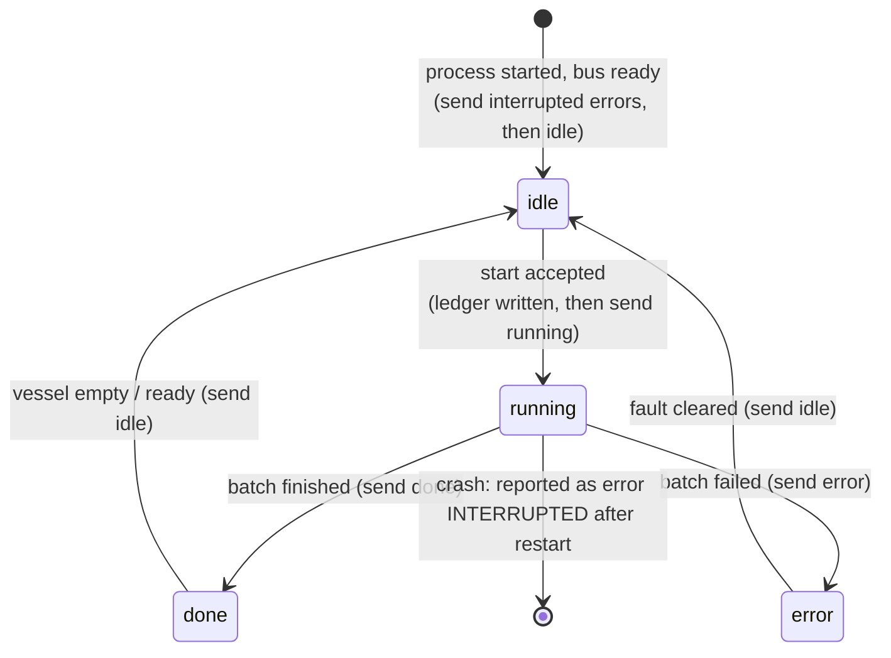
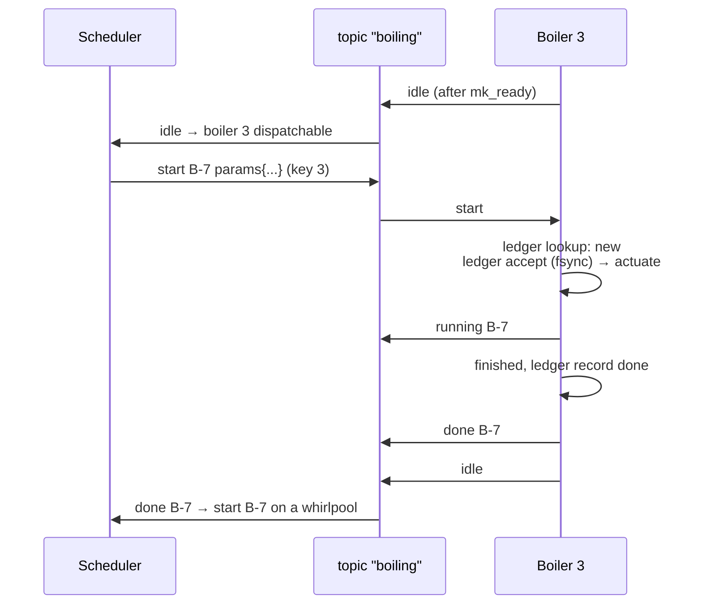
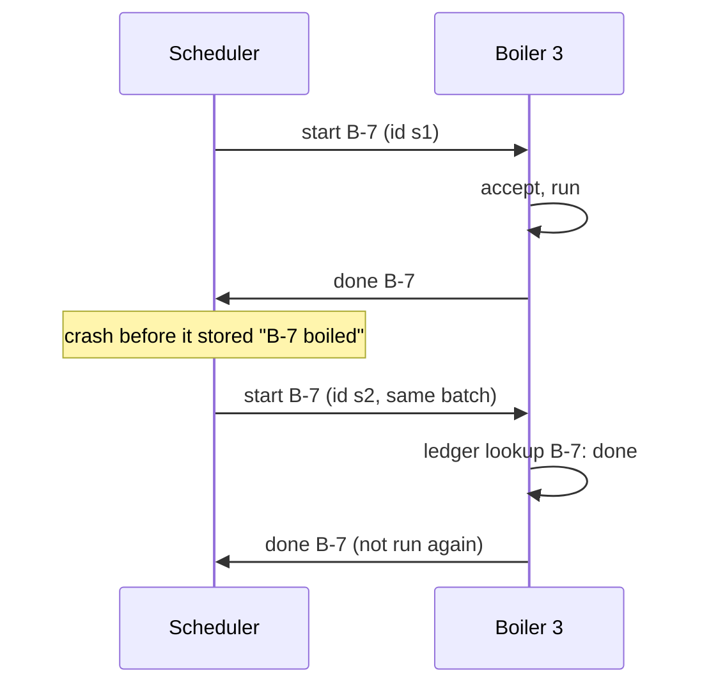
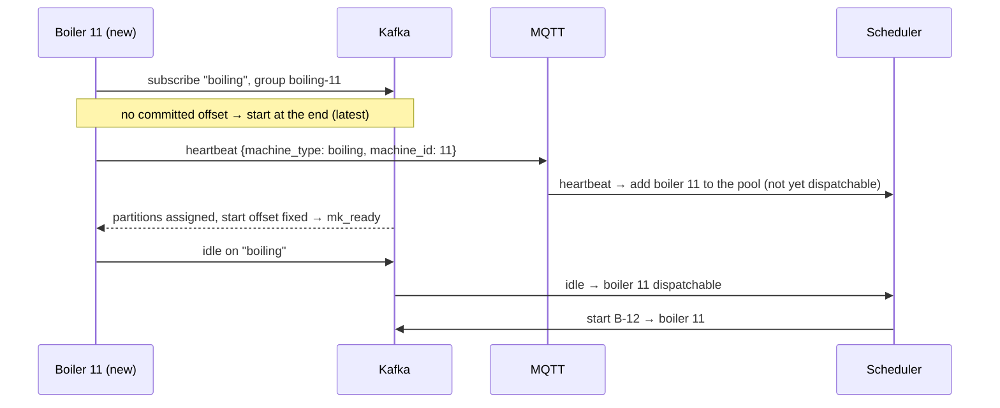

# Kafka production bus: design

This document is the contract between the machines, the scheduler and the
(future) Java backend. Everything a non-C implementation needs is here; the C
library `machine_kafka` is one implementation of it.

Contents

1. [Roles and topics](#1-roles-and-topics)
2. [Message schema (v3)](#2-message-schema-v3)
3. [Machine states](#3-machine-states)
4. [Sequences](#4-sequences)
5. [Duplicate protection: what is guaranteed](#5-duplicate-protection-what-is-guaranteed)
6. [Adding machines (QA-5)](#6-adding-machines-qa-5)
7. [Configuration and the reason for each setting](#7-configuration-and-the-reason-for-each-setting)
8. [Failure scenarios](#8-failure-scenarios)
9. [What the idempotent producer does and doesn't guarantee](#9-what-the-idempotent-producer-does-and-doesnt-guarantee)
10. [Smaller design decisions](#10-smaller-design-decisions)
11. [Requirements mapping](#11-requirements-mapping)

---

## 1. Roles and topics

Production order: mashing → lautering → boiling → whirlpooling →
fermentation (incl. maturation) → filtering (incl. carbonation). Each machine
type can have several instances (boiler 1–10, several tanks), identified by
`(machine_type, machine_id)`.

The scheduler waits for `done` from one stage, then sends `start` to a free
machine of the next stage. Machines report liveness with MQTT heartbeats
(`../machine_mqtt`), not over Kafka.

### Topics

One topic per machine type, named after the type:

| Topic = machine type | Key | Written by | Read by | Partitions | Content |
|---|---|---|---|---|---|
| `mashing`, `lautering`, `boiling`, `whirlpooling`, `fermentation`, `filtering` | `machine_id` as decimal string (`"3"`) | the scheduler (commands; later also the Java backend for stop/flush) and every machine of the type (statuses) | every machine of the type, each in its own consumer group `<type>-<id>`, takes the commands; the scheduler (group `scheduler`) takes the statuses; a backend / log viewer reads everything in its own group | 1 | `start`, `stop`, `flush`, `idle`, `running`, `done`, `error` |

Machine type rules: `[a-z][a-z0-9_-]*`, max 31 characters. The names match
the machine folders (`fermentation_maturation` is the `fermentation` type:
one start covers fermentation and maturation in the same tank).

**One topic for both directions.** Commands and statuses of a type share its
topic. Each reader skips the direction that is not for it: `mk_poll` hands a
machine only commands (`receive = MK_RECEIVE_COMMANDS`) and the scheduler
only statuses (`MK_RECEIVE_STATUSES`); everything else is committed and
skipped without calling the handler. A machine also sees the commands for its
siblings (same type, other `machine_id`) and ignores them by `machine_id`.

Compared with a separate commands and status topic per type (schema v2):

| | one topic (chosen) | two topics |
|---|---|---|
| Topics to create and watch | 6 | 12 |
| What a machine reads | commands **and** all statuses of its type, skips the statuses | only commands |
| What the scheduler reads | statuses **and** its own commands, skips the commands | only statuses |
| Reading one batch in the Kafka UI | start, running and done next to each other, in order | split over two topics |
| Different retention / ACLs per direction | no | possible |

At this volume (a few hundred messages a day per type, section 10.4) reading
and skipping the other direction costs nothing measurable, and one topic per
type is simpler to operate and to follow.

**Key = machine_id.** All messages for one machine land in one partition, so
they are read in the order they were written (Kafka orders per partition).

**Why 1 partition.** Each machine has its own consumer group and reads the
whole topic anyway, the scheduler is a single consumer, and the volume is
tiny. One partition also gives a total order per stage, which makes the log
easy to follow (QA-4). The key is still set, so partitions can be added later
without code changes; do that while the line is idle, because adding
partitions changes which partition a key maps to.

---

## 2. Message schema (v3)

Encoding: the Kafka **value** is one UTF-8 JSON object; the Kafka **key** is
`machine_id` as a decimal UTF-8 string. No Kafka headers are used.

### 2.1 Fields

Every message has **all** of these keys; a field that does not apply is
`null`. Readers must ignore keys they don't know (forward compatibility).

| Field | JSON type | Required for | Meaning |
|---|---|---|---|
| `schema_version` | integer | all | `3`. Readers reject other versions. |
| `message_id` | string (id) | all | Unique per message. Set by the sender (C: `<client_id>-<start-time-hex>-<seq>`; Java: a UUID is fine). Used to recognise a redelivered start (section 5.3) and for tracing. |
| `type` | string | all | `start`, `stop`, `flush` (commands) or `idle`, `running`, `done`, `error` (statuses). |
| `machine_type` | string | all | `[a-z][a-z0-9_-]*`, max 31 chars. Also the topic name. |
| `machine_id` | integer | all | ≥ 1, instance number within the type. Also the Kafka key. |
| `batch_id` | string (id) or null | start, flush, running, done | Batch the message is about. Optional for `stop` and `error`, null for `idle`. |
| `ts_utc` | string (id) or null | should always be set | Send time, ISO-8601 UTC, e.g. `2026-11-19T10:00:00Z` (fractions allowed). Used for command expiry. |
| `params` | object or null | start (may be `{}`) | Recipe parameters: name → finite number. Ignored on other types. |
| `error` | object or null | error | `{"code": id, "reason": string or null}`. Ignored on other types. |

Limits and character sets (the C side rejects anything else as malformed):

| What | Allowed | Max length |
|---|---|---|
| `message_id` | `[A-Za-z0-9._:-]` | 95 |
| `batch_id` | `[A-Za-z0-9._:-]` | 63 |
| `error.code`, param names | `[A-Za-z0-9._:-]` | 31 |
| `ts_utc` | `[A-Za-z0-9._:-]` | 31 |
| `error.reason` | any text | 127 bytes (UTF-8) |
| `params` | finite numbers, unique names | 16 entries |

The id character set contains nothing JSON has to escape, which makes the
largest possible message computable: about 1.3 KB (test `test_max_size`); the
C buffer `MK_MAX_JSON_LEN` is 4 KB.

A status is matched to its command by `(machine_type, machine_id, batch_id)`:
each machine runs a batch at most once (section 5), so that is unique.

### 2.2 Per type

| type | direction | batch_id | params | error |
|---|---|---|---|---|
| `start` | scheduler → machine | required | object | null |
| `stop` | → machine | optional (null = whatever runs) | null | null |
| `flush` | → machine | required | null | null |
| `idle` | machine → scheduler | null | null | null |
| `running` | machine → scheduler | required | null | null |
| `done` | machine → scheduler | required | null | null |
| `error` | machine → scheduler | if about a batch | null | required |

`stop` (FR-13) stops a single machine. `flush` (FR-14) discards a batch from
a machine: a batch that spoiled (its hold deadline passed) or that the
operator cancelled is removed and its loss is recorded once
(`IMPLEMENTATION_PLAN.md`, "Flush"). The machine answers both with an `error`
status whose code is the outcome (`STOPPED`, `FLUSHED`, see 2.3), because
the batch does not move on. A stopped or flushed batch is recorded in the
ledger, so a re-sent start never runs it again. The whirlpooling controller
implements both (`whirlpooling/src/main.c`); a machine that does not implement
them yet answers `UNSUPPORTED`.

### 2.3 Error codes

`error.code` is an open set of ids. Codes used so far:

| Code | Sent when | Batch state afterwards |
|---|---|---|
| `BUSY` | start arrives while another batch runs | start was not executed; scheduler may retry later / elsewhere |
| `MISSING_PARAM`, `INVALID_PARAM` | params incomplete or out of range | not executed |
| `INTERRUPTED` | the machine restarted while the batch was running | partly executed; operator decides (flush) |
| `UNSUPPORTED` | command type not implemented yet | not executed |
| `STOPPED` | answer to `stop`: the machine stopped the batch (kettle: heater off, wort stays) | partly executed; waits for `flush` |
| `FLUSHED` | answer to `flush`: the batch was discarded; `idle` follows | discarded |
| `NOT_RUNNING` | `stop` while nothing (or another batch) runs | nothing changed |
| `NOT_HERE` | `flush` of a batch that is not in this machine | nothing changed |
| machine specific (`OVERHEAT`, …) | the batch failed while running | partly executed; operator decides |

### 2.4 Examples

```json
{"schema_version":3,"message_id":"scheduler-6aff1da4-17","type":"start",
 "machine_type":"boiling","machine_id":3,"batch_id":"B-0007",
 "ts_utc":"2026-11-19T10:00:00Z",
 "params":{"target_temp_c":100,"duration_s":3600,"hops_g":250,"hops_at_s":600},
 "error":null}
```

```json
{"schema_version":3,"message_id":"boiling-3-6aff1c00-1","type":"idle",
 "machine_type":"boiling","machine_id":3,"batch_id":null,
 "ts_utc":"2026-11-19T09:58:12Z","params":null,"error":null}
```

```json
{"schema_version":3,"message_id":"boiling-3-6aff1c00-2","type":"running",
 "machine_type":"boiling","machine_id":3,"batch_id":"B-0007",
 "ts_utc":"2026-11-19T10:00:01Z","params":null,"error":null}
```

```json
{"schema_version":3,"message_id":"boiling-3-6aff1c00-3","type":"done",
 "machine_type":"boiling","machine_id":3,"batch_id":"B-0007",
 "ts_utc":"2026-11-19T11:00:04Z","params":null,"error":null}
```

```json
{"schema_version":3,"message_id":"boiling-3-6aff1c00-4","type":"error",
 "machine_type":"boiling","machine_id":3,"batch_id":"B-0008",
 "ts_utc":"2026-11-19T11:02:00Z","params":null,
 "error":{"code":"OVERHEAT","reason":"kettle above 105 C, heater off"}}
```

```json
{"schema_version":3,"message_id":"backend-5f0c…","type":"flush",
 "machine_type":"fermentation","machine_id":2,"batch_id":"B-0005",
 "ts_utc":"2026-11-19T12:00:00Z","params":null,"error":null}
```

### 2.5 Recipe parameters (QA-7)

`params` is a flat JSON object of name → number. New recipes only change
values (and possibly add parameter names that a machine already
understands), so they need no code change in the library, the scheduler's
transport code or the backend.

**Selecting Beer A or Beer B.** Machines have no "set recipe" command: the
recipe of a batch travels with each `start`. When the supervisor selects
Beer B for a new batch, the backend/scheduler resolves Beer B's recipe
version at admission and, for every stage, copies that machine type's
parameters into the start it sends for this batch. Every stage controller therefore
receives the Beer B parameters when the batch reaches it; batches already in
the line keep their own parameters, which is what "when the production line
allows for it" requires (`IMPLEMENTATION_PLAN.md`: active batches never
change recipe).

Suggested names (snake_case with a unit suffix); the library does not
interpret them, each machine documents the ones it reads:

| Machine type | Parameters |
|---|---|
| mashing | `target_temp_c`, `duration_s`, `speed_rpm` |
| lautering | `water_temp_c`, `water_flow_lpm`, `duration_s` |
| boiling | `target_temp_c`, `duration_s`, `hops_g`, `hops_at_s` (more additions: `hops_2_g`, `hops_2_at_s`, …) |
| whirlpooling | `speed_rpm`, `duration_s` |
| fermentation | `fermentation_temp_c`, `fermentation_s`, `maturation_temp_c`, `maturation_s`, `yeast_g` |
| filtering | `target_temp_c`, `sugar_g`, `co2_volumes` |

**Why name → number, at most 16, instead of a raw JSON object string.**

| | name/number pairs (chosen) | raw JSON string in `params` |
|---|---|---|
| C machine code | `mk_param_get(msg, "hops_g", &v)`; no JSON parser in the machine | every machine parses JSON itself (cJSON leaks into all machines) |
| Validation | at the bus: non-numbers, NaN/∞, duplicates, too many → message rejected | scattered over machines |
| Size | bounded (16 × 31-char names) → fixed buffers | unbounded |
| Java | `Map<String, Double>` | `JsonNode` / `String` |
| Expressiveness | numbers only | anything (strings, lists, nesting) |

Every value a machine actuates on is a number (temperature, speed, time,
amount). Names like the hop *variety* belong to inventory/recipe data, not
to the actuator. If nested data is ever needed, add a new optional field;
readers ignore unknown fields, so that is backward compatible.

### 2.6 Versioning

`schema_version` changes only for incompatible changes:

- v1 → v2: separate commands/status topics, new types.
- v2 → v3: one topic per machine type named after it; `step`, `reply_to` and
  `progress` removed (each machine runs one thing per batch, statuses are
  matched by batch, progress is not used); duplicate protection keyed on
  `batch_id`.

Adding optional fields or new values of `type` / `error.code` does not bump
the version; readers ignore unknown fields. Unknown `type` values are
rejected by the C decoder as malformed (logged and skipped), so a new command
type should be introduced on the scheduler side only after the machines
understand it.

### 2.7 Java notes

- Deserialize with unknown properties ignored
  (`DeserializationFeature.FAIL_ON_UNKNOWN_PROPERTIES = false`); `type` works
  as the Jackson type discriminator.
- Key/value serializers: `StringSerializer` for both.
- Producer: `enable.idempotence=true`, `acks=all`, `linger.ms=0`,
  `delivery.timeout.ms=2147483647` (Java has no "0 = forever"), default
  partitioner (murmur2, the same as the C side, see section 7).
- Consumer: `enable.auto.commit=false`, commit after handling; skip the
  direction you don't handle (`type` in start/stop/flush = command). A
  backend that only displays the log uses its own group id.

---

## 3. Machine states

A machine sends a status message on every state change.



- `idle` means "ready for a start". The scheduler only dispatches to machines
  whose latest status is `idle` (and whose heartbeat is alive).
- `done` means "this machine's work on `batch_id` is finished"; the scheduler
  moves the batch to the next stage. A tank can be `done` but not yet `idle`
  while it still holds the beer; it sends `idle` once it is empty.
- `error` means the batch does **not** move on.
- A start that arrives while `running` is answered `error BUSY` (another
  batch) or with `running` again (the same batch).
- Status is not liveness: a dead machine stops sending heartbeats, not
  status. The last status of a crashed machine stays `running` until the
  heartbeat loss is noticed (section 8).

---

## 4. Sequences

### 4.1 Happy path



Every message on the topic reaches both sides; the machine skips the
statuses and the scheduler skips the commands (not drawn).

### 4.2 Error path

```mermaid
sequenceDiagram
    participant S as Scheduler
    participant M as Boiler 3
    S->>M: start B-8
    M->>M: ledger accept, actuate
    M->>S: running B-8
    M->>M: overheat, heater off<br/>ledger record error
    M->>S: error OVERHEAT B-8
    Note over S: B-8 does not move on;<br/>operator alarm (BPS-5/BPS-7)
    M->>S: idle (fault cleared)
```

### 4.3 Duplicate start (scheduler restart re-sends with a new message_id)



While the batch is still running, the duplicate gets `running` back instead.

### 4.4 Machine restart (crash before the offset commit)

```mermaid
sequenceDiagram
    participant S as Scheduler
    participant K as Kafka
    participant M as Boiler 3
    participant L as ledger file
    S->>K: start B-9
    K->>M: start B-9 (offset 41)
    M->>L: accept (R B-9 ...), fsync + rename
    M->>M: actuate
    Note over M: crash: offset 41 never committed
    M->>L: restart: load; R → E INTERRUPTED
    M->>S: error INTERRUPTED B-9
    M->>S: idle
    K->>M: start B-9 again (offset 41, uncommitted)
    M->>M: lookup: B-9 known
    M->>S: error INTERRUPTED B-9 (not run again)
```

### 4.5 Adding boiler 11



---

## 5. Duplicate protection: what is guaranteed

### 5.1 The guarantee

> A machine never runs the same batch twice: one
> `(machine_type, machine_id, batch_id)` is actuated at most once, across
> scheduler restarts, machine restarts and Kafka redeliveries, as long as the
> machine's ledger file survives and the batch is among the last 16 batches
> the machine handled.

Not guaranteed (and not needed):

- **Not exactly-once delivery.** Messages are delivered at least once; a
  status can arrive twice (e.g. a replayed `done`). The scheduler must treat
  statuses as idempotent facts: a `done` for a batch it already moved on is
  ignored.
- **Not "every batch is executed".** A start can be lost (machine crash, lost
  `done`); the scheduler detects that with a timeout or the heartbeat and
  decides (re-send start, which is safe; or operator).
- **Not across machines.** The ledger is per machine. The same batch sent to
  two different boilers runs on both; avoiding that is the scheduler's job.
- **Not resumption.** A batch interrupted by a restart is never resumed
  automatically; it is reported `error INTERRUPTED`.

### 5.2 Why message-id dedup was not enough

The first version remembered the last 32 `message_id`s in memory. It missed
both cases that matter:

| Case | message_id | in-memory ring | result |
|---|---|---|---|
| Scheduler restarts and re-sends the start | **new** | not matched | ran twice |
| Machine restarts, start redelivered | same | **empty** | ran twice |

### 5.3 The ledger

`mk_ledger_t` (`ledger.c`) keys accepted batches on `batch_id` and stores the
last `MK_LEDGER_SIZE = 16` entries in a text file whose path the machine
chooses (e.g. a Docker volume `/var/lib/<machine>/ledger-<id>.state`):

```
mk-ledger 2 boiling 3
D B-0007 scheduler-6aff1da4-17 - 
E B-0008 scheduler-6aff1da4-21 OVERHEAT kettle above 105 C
X B-0009 scheduler-6aff1da4-22 BUSY B-0008
R B-0010 scheduler-6aff1da4-30 - 
```

Columns: state, batch, `message_id` of the start, error code, reason. `R`
running, `D` done, `E` error, `X` refused without running (BUSY etc.).
Writes go to `<path>.tmp`, are `fsync`ed and then `rename`d over the old file
(atomic on POSIX), so a crash leaves the old or the new version. A file that
cannot be parsed or belongs to another machine makes `mk_ledger_open` fail:
the machine should refuse to start rather than run without protection.

Machine flow for each start addressed to it:

1. `mk_ledger_lookup` → known? send the returned status (`running` /
   `done` / `error`) and stop.
2. Busy or invalid params? `mk_ledger_refuse` builds the `error`, stores it
   as `X` keyed by this start's `message_id` only, and the machine sends it.
   A redelivery of this same message gets the same answer; a new attempt
   from the scheduler (new `message_id`) is evaluated again.
3. `mk_ledger_accept` (file written) → **only now** actuate.
4. When finished: `mk_ledger_record(done|error)`, then `mk_send`.

At startup `mk_ledger_open` turns every `R` into `E INTERRUPTED`;
`mk_ledger_next_interrupted` returns those errors once so the machine can
report them right after it becomes ready.

### 5.4 The remaining windows

`mk_poll` commits the offset after the handler returns. Kafka therefore
redelivers everything a crashed machine had received but not committed.

| Crash point | After restart | Executed |
|---|---|---|
| before `mk_ledger_accept` returned | start redelivered, not in ledger | once (now) |
| after accept, before/while actuating, before commit | start redelivered; ledger has it (`INTERRUPTED`) | once (partly); reported |
| after accept and commit, while running | not redelivered; ledger reports `INTERRUPTED` | once (partly); reported |
| after `done` queued, before the broker got it | `done` lost; scheduler times out and re-sends start; ledger answers `done` | once |
| after refusing (BUSY), before commit | start redelivered; ledger has `X` for that message_id → BUSY again | never |

The persisted check is what closes the "accepted but not committed" window:
the ledger is written *before* anything physical happens, so a redelivered
start always finds it. The order "write ledger, then actuate" is the only
rule a machine must not break.

Still open (by design, documented):

- **Ledger file lost** (volume deleted, new hardware): protection is gone.
  Mitigated by `auto.offset.reset=latest` (no history replay) and command
  expiry (nothing older than 5 minutes is executed).
- **More than 16 newer batches** pushed an entry out of the ledger, then its
  start arrives again: only possible if the message is older than the
  command expiry, so it is dropped anyway.

---

## 6. Adding machines (QA-5)

### 6.1 Another machine of an existing type: zero changes

Boiler 11 is started with `machine_type=boiling`, `machine_id=11`. With no
configuration file, topic or Kafka admin work:

1. It subscribes to the `boiling` topic with its own group `boiling-11`
   (`group_id` defaults to `client_id`).
2. It starts MQTT heartbeats (not this library).
3. When `mk_ready()` is 1 it sends `idle` on `boiling`.
4. The scheduler adds it to the pool when it sees the heartbeat and
   dispatches to it once it has seen its `idle`.

### 6.2 A new machine type: one topic and a scheduler stage

`docker compose run --rm topics centrifuge` (or
`./scripts/create-topics.sh centrifuge`) creates the `centrifuge` topic. The
scheduler lists its topics explicitly (`MK_MACHINE_TYPES` in C), so the new
type is added there, next to the new stage in the scheduler's process model,
which is needed anyway. No library change.

(Schema v2 used a regex over `machine.*.status` so the scheduler found new
types by itself. Without the `machine.` prefix a regex could not tell machine
topics from other topics, and the scheduler needs a code change for a new
stage in any case.)

### 6.3 Where a new consumer group starts: `latest` for machines, `earliest` for the scheduler

`auto.offset.reset` only matters when a consumer group has **no committed
offset**: a brand-new machine, a machine whose offsets expired
(`offsets.retention.minutes`, default 7 days), or a scheduler with a new
topic in its list.

- **Machines: `latest`** (default for `MK_RECEIVE_COMMANDS`). A replacement
  boiler 3 with an empty disk, or one whose offsets expired, would otherwise
  read the whole command history (30 days) and could re-run old starts. With
  `latest` it only sees commands sent after it became ready. Commands it
  missed while it did not exist are, by definition, not meant for it.
- **Scheduler: `earliest`** (default for `MK_RECEIVE_STATUSES`). The
  scheduler must never miss a status. Its offsets normally exist (it resumes
  after its last commit), so `earliest` only applies to a first start or a
  newly added topic, where the new type's first `idle` may already be there.
  Reading old statuses is harmless because the scheduler treats statuses as
  idempotent facts.

**The race `latest` alone does not close.** librdkafka resolves "latest"
lazily, some time after the partition assignment. A start sent between "the
machine said idle" and "the machine looked up the end offset" would be
skipped. The library therefore resolves the start offset itself inside the
rebalance callback (committed offset, else the current end offset) before
it assigns the partition, and only then reports `mk_ready() == 1`.
Machines send their first `idle` only after that, and the scheduler only
dispatches after `idle`. Tested in `test_bus` scenario 4.

### 6.4 The scheduler service

`backend/src/scheduling` (`scheduler.h`) is the scheduler's Kafka side, ready
for the scheduling policy:

- `scheduler_open` subscribes to every machine type (`MK_MACHINE_TYPES`) with
  `MK_RECEIVE_STATUSES` in consumer group `scheduler`.
- `scheduler_poll` stores each status in a machine table (one row per
  `(machine_type, machine_id)`: state, batch, error, last `ts_utc`) and then
  calls `dispatch()`.
- `dispatch()` (`dispatch.c`) is the one place for the policy. It reads the
  table (`scheduler_machines`) and sends work with `scheduler_start` (params
  such as `duration_s`), `scheduler_stop` and `scheduler_flush`. It is empty
  today.

A new machine needs no change here: its first status adds its row.

---

## 7. Configuration and the reason for each setting

### 7.1 Producer (every bus)

| Setting | Value | Why |
|---|---|---|
| `enable.idempotence` | `true` | broker discards duplicates caused by producer retries; keeps order per partition with retries (section 9) |
| `acks` | `all` | a message counts as written only when all in-sync replicas have it (implied by idempotence) |
| `linger.ms` | `0` | send immediately; a command must not wait for a batch to fill |
| `compression.type` | `none` | messages are < 2 KB; compression would only cost CPU |
| `message.timeout.ms` | `0` (forever) | a `done` must survive a broker restart; stale commands are handled at the receiver (section 10.1) |
| `partitioner` | `murmur2_random` | same partitioner as the Java client: a key lands on the same partition whether C or Java wrote it |
| delivery report callback | `mk_config_t.on_delivery_failure` | permanent failures (e.g. topic missing) reach the application (section 10.2) |

### 7.2 Consumer (bus with topics)

| Setting | Value | Why |
|---|---|---|
| `group.id` | `group_id`, default `client_id` (`boiling-3`) | each machine instance has its own group, so it sees every command of its type |
| `enable.auto.commit` | `false` | commit only after the handler ran (at-least-once) |
| `auto.offset.reset` | `latest` for machines, `earliest` for the scheduler (overridable) | section 6.3 |
| rebalance callback | fixes start offsets, then `assign` | makes `mk_ready()` exact (section 6.3) |
| commit | `rd_kafka_commit_message`, synchronous, after each message (also skipped ones) | section 10.4 |

Library-level: `receive` (which direction reaches the handler) and
`command_max_age_s` (default 300 s): commands older than this by `ts_utc` are
logged and skipped.

Defaults worth knowing: `max.poll.interval.ms` = 300 000. The machine loop
must call `mk_poll` at least every 5 minutes or the consumer leaves the
group; never block in the handler (do the long work in the main loop, as in
the examples).

### 7.3 Broker and topics

| Setting | Dev (docker-compose) | Production | Why |
|---|---|---|---|
| `auto.create.topics.enable` | `false` | `false` | a typo in a machine type must fail loudly (delivery-failure callback), not create a topic nobody reads |
| partitions | 1 | 1 | section 1 |
| replication factor | 1 | 3 | with RF 1, `acks=all` waits for one broker only: losing its disk loses messages, and the broker is a single point of failure (QA-8) |
| `min.insync.replicas` | 1 | 2 | with RF 3: a write survives one broker loss, and producers keep working with one broker down |
| `retention.ms` | 30 days | 30 days (or more) | traceability (QA-4): the operator can replay what was sent; long-term batch records belong in the backend database (FR-11) |
| `cleanup.policy` | `delete` | `delete` | compaction would keep only the last message per `machine_id` and destroy the history |
| `offsets.retention.minutes` | 7 days (default) | ≥ 7 days | how long a stopped machine's position is remembered (section 6.3) |

The broker also has the internal topic `__consumer_offsets`: every offset
commit of every consumer group is a message there. It is how a restarted
machine knows where to continue. Kafka manages it; never write to it.

---

## 8. Failure scenarios

| Scenario | What happens | What protects us |
|---|---|---|
| **Broker down** | `mk_open`/`mk_send` still succeed; messages wait in librdkafka's queue and are retried forever. librdkafka logs "all brokers are down". Consumers get nothing. | Statuses arrive when the broker is back. Commands that waited longer than 5 min are dropped by the machine; the scheduler re-sends after its timeout, safe because of the ledger. |
| **Broker down between consume and commit** | Commit fails (logged); message redelivered later. The synchronous commit can block `mk_poll` while the coordinator is unreachable. | Ledger turns the redelivery into a status replay. |
| **Machine crash** | Section 5.4. Heartbeats stop. Uncommitted commands are redelivered after restart. Queued but undelivered statuses are lost. | Ledger (no double execution), `INTERRUPTED` report at restart, scheduler timeout + re-send for lost statuses. |
| **Machine disk / ledger lost** | Duplicate protection lost for old batches. | `latest` + command expiry: nothing older than 5 min and nothing before the restart is re-read. |
| **Scheduler crash / restart** | Resumes at its committed offset and reads the statuses sent while it was down. Its in-memory view (which batch is where) is gone. | Statuses are facts it can rebuild from; re-sending a start to rebuild state is safe (the machine replies with its last status). How the scheduler persists its own state is open. |
| **Scheduler sends to a machine that just died** | Start waits in the topic; the machine reads it after restart if it is younger than 5 min, otherwise drops it. | Scheduler dispatches only to machines with a live heartbeat and latest status `idle`; on heartbeat loss it must re-plan (open question). |
| **Malformed or misplaced message** | Logged with topic/partition/offset, committed and skipped by every reader of the topic; the consumers continue. | Decoder validation + "machine_type must match topic" check. |
| **Missing topic** (new type, script not run) | Send fails (at the latest after `topic.metadata.propagation.max.ms`, 30 s) with "Unknown topic or partition"; `on_delivery_failure` is called. | Callback + `mk_delivery_failures`. |

---

## 9. What the idempotent producer does and doesn't guarantee

Does:

- **No duplicates from retries.** Each producer gets a producer id (PID) and
  numbers its messages per partition; the broker drops a retry it already
  stored. A network glitch during send cannot create two copies.
- **No reordering from retries.** Messages to one partition are stored in the
  order `mk_send` was called, even when some were retried.
- **`acks=all`.** A message is acknowledged only when all in-sync replicas
  have it.

Doesn't:

- **Doesn't survive a restart of the producer.** A restarted process gets a
  new PID; anything it re-sends is a new message.
- **Doesn't dedupe the application.** Calling `mk_send` twice (or a
  scheduler re-sending a start) produces two messages. That is why the
  receiver needs the ledger.
- **Doesn't make processing exactly-once.** Kafka's exactly-once (transactions)
  only covers "read from Kafka → write to Kafka". Heating a kettle is outside
  Kafka; its at-most-once execution comes from the ledger.
- **Doesn't keep messages that never left the process.** `mk_send` queues in
  memory; a crash before delivery loses them (`mk_close` flushes on a clean
  shutdown and returns how many were left).
- **Doesn't protect against broker data loss** with replication factor 1.

---

## 10. Smaller design decisions

### 10.1 `message.timeout.ms=0` and command expiry

Retrying forever is right for statuses: a `done` must not be lost because
Kafka restarted. For commands it means a start queued during a broker outage
can reach a machine much later, when the scheduler has given up on it.

Decision: keep retry-forever in the producer, and let the **receiver** drop
commands whose `ts_utc` is older than `command_max_age_s` (default 300 s).

Alternatives considered:

- *Finite `message.timeout.ms` for commands.* Bounds the time in the
  producer queue only, not time spent in the topic (e.g. machine offline),
  and needs per-topic configuration in the producer.
- *Kafka message timestamp instead of `ts_utc`.* Equivalent with CreateTime;
  `ts_utc` is visible in the JSON, so the Java side and the Kafka UI show the
  same value.

Requirement: machine and scheduler clocks must be within a few seconds
(NTP; containers on one host share the host clock). Commands without a
parsable `ts_utc` are not expired.

### 10.2 Delivery failures

`mk_config_t.on_delivery_failure(msg, reason, user)` is called with the
decoded message for every message the broker permanently rejected, so a
machine can e.g. log the lost `done` or raise an alarm. With retry-forever
the realistic cause is a missing topic or a broker rejecting the message,
both configuration errors, so the callback is optional and a counter
(`mk_delivery_failures`) exists as well.

### 10.3 Topic creation

`scripts/create-topics.sh` creates the 6 topics with explicit partitions,
replication factor, `min.insync.replicas`, retention and `cleanup.policy`,
and warns about `acks=all` with RF 1. `docker-compose.yml` runs it
automatically and disables auto-creation.

### 10.4 Synchronous commit per message

Estimated volume: ~100 000 L/month, so roughly 50–100 batches per month,
6 machine types, about 4 messages per batch and machine. That is a few
hundred messages per day per topic. A synchronous commit costs a round trip
to the group coordinator (~1–5 ms on a LAN), so the limit would be a few
hundred messages per second per consumer. Acceptable, even though every
reader now also commits the messages of the other direction it skips.

Telemetry (temperatures at 1 Hz, FR-10) goes over MQTT, not Kafka. The
alternative, asynchronous commits, would only increase redeliveries, which
the ledger already makes harmless; it can be switched if the volume ever
grows.

### 10.5 Message must match its topic

`mk_poll` rejects a message whose `machine_type` is not the topic it was read
from (e.g. a mashing start on the boiling topic). Otherwise boiler 3 would
act on a mashing start addressed to id 3.

---

## 11. Requirements mapping

| Requirement | How the bus supports it |
|---|---|
| **FR-2** run steps in order, start each after the previous reported completion | `done` per `batch_id` on the machine type's topic; scheduler sends the next `start` (to the next machine type) only after it; `error` stops the batch. Ordered per machine by key = `machine_id`. |
| **FR-11** batch record (beer type, start/end of each step, sensor values) | `start` (with params), `running` and `done` carry `batch_id` and `ts_utc` = start and end at each machine type; consumed by the backend from the topics (own group) and stored in Postgres. Sensor values: MQTT telemetry, not this bus. |
| **FR-13** stop a single machine | `stop` command already in the schema and the C API (`mk_make_command(MK_STOP, ...)`); machines answer `error UNSUPPORTED` until implemented. Emergency stop stays local (QA-6: 50 ms is not a Kafka round trip). |
| **FR-14** flush a batch from a machine | `flush` command with `batch_id` already in the schema. Flushing should also allow a retry of that batch later (open question). |
| **QA-3** correctness, recover from expected errors | Validation on encode and decode; malformed and misplaced messages skipped without crashing; ledger prevents double execution; `INTERRUPTED` after restart; broker outage tolerated. |
| **QA-4** traceability, live log of scheduler messages | Every command and status is a retained message (30 days) with `message_id` and `ts_utc`; one topic per machine type holds a batch's start, running and done in order; Kafka UI on port 8080; a log viewer reads the topics in its own group. |
| **QA-5** integrability, add machines | Section 6: same type = zero config; new type = one topic + scheduler stage; `latest` + `mk_ready` for safe joining. |
| **QA-7** new recipes without code changes | `params` name → number in `start` (section 2.5). |
| **QA-8** availability 99.99 % | Clients tolerate broker restarts (retry forever, reconnect); single dev broker is a SPOF: production needs 3 brokers, RF 3, `min.insync.replicas=2`; machines keep their state (ledger) across restarts. |
